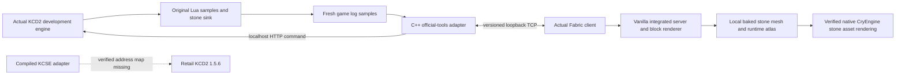

# MineCome architecture

Status: implemented control-plane prototype, partial live verification; not a playable
mashup yet. Research and evidence date: 2026-10-11.

## Decisions grounded in inspected sources

SkyCraft's current implementation exports Minecraft meshes/atlases and renders them
in Skyrim; its draft DESIGN.md GPU-sharing plan does not describe all current code.
It also uses host collision data and custom triangle motion adjustment in Minecraft.
Universal Modder's GTA example sends CPU colour/depth frames through shared memory
and composites with host depth. These are distinct approaches. Skyrim APIs, vtables,
scale, renderer formats and physics behavior are not portable to KCD2.

libKCD2 targets 1.5.6 and isolates shuffled CryEngine virtual layouts. The installed
Steam retail executable is 1.5.6.0/build23914554/assembly15693, with the documented
binary configuration, but no verified address library exists locally or in inspected
upstream releases. KCSE hooks engine addresses before checking plugins. Therefore
the retail loader is not installed. A plugin version check alone would not protect
the process. The real KCSE DLL is compiled and standalone ABI-tested, with engine
dereferences disabled.

The installed official modding tools are a separate 1.5.5 development build. Its
documented localhost1403 HTTP server was verified live, and the original Lua module
initialized and logged camera data. This provides an independently testable engine
access route while retail native prerequisites are missing.

## Principal components

**A — KCD2 integration.** The KCSE adapter owns a `Bridge` and lifecycle logging.
It accepts only the explicit supported version and uses no unverified memory offsets.
Network work stays off the game thread. For current live tests, an original Lua
module runs inside the official development game; an external C++ WinHTTP adapter
requests its read-only sample function on the engine console and tails fresh log
records. It forwards genuine camera/player values through the same `Bridge`, and
confirms Minecraft receipts with a documented in-game Lua log command. This adapter
is slower and development-only, but does not depend on reverse-engineered addresses.
Optional `--mirror-stone` forwards authenticated Minecraft stone changes through
the official console onto the engine thread. A bounded copied event mailbox carries
connection/reset generations, wire sequence and fresh pose at receipt; harness
events cannot cause game writes. The consumer requires a Lua Begin receipt before
any Apply, serializes operations until complete engine log receipts arrive, and
requires confirmed cleanup before acknowledging reset or starting another session.
Enabling real mirroring also verifies the official development executable's exact
metadata, distribution path and currently running process image before any console
mutation. The actual installed EXE has fixed version resource `1.0.0.0` and translated
FileVersion/ProductVersion strings `1.5.5.0`; the gate checks that observed combination,
including both strings within one resource translation. Explicit standalone fixture
mode is confined to a separate
fixture log and a non1403 port and marks its evidence as simulated.

The live Lua/console boundary rounds numeric inputs like float32. Session and event
sequence IDs therefore cross this boundary as quoted canonical decimal strings and
stay textual inside Lua; its JSON receipts emit those validated digits unchanged.
The TCP codecs retain their u64 sequence/i32 coordinate representation. The Lua sink
limits Minecraft cell coordinates to the exact integer range ±16777215.

The combined test helper copies the original workspace Lua module to a unique
read-only `runtime/hotload/<timestamp-GUID>/minecome.lua` snapshot, checks that its
SHA256 matches the source, and calls documented `Script.LoadScript` on that fresh
absolute path on the engine thread. In the actual tools build, `ReloadScript` on
the old path left the function unchanged and did not prove reevaluation. Success
therefore requires a changed `BeginBlockSession` function reference and the expected
token contract in a fresh log marker. Ownership and timers are preserved. Evidence
records original/snapshot paths, both matching hashes and `FunctionReloadVerified`;
the staged package has its own fingerprint. An open game keeps its existing package,
so staging a new package is deferred until KCD2 closes normally.

**B — real Minecraft Fabric client.** Minecraft1.21.1 retains its real player physics,
inventory, integrated server, block states, crafting and rendering. Client ticks copy
player/camera snapshots into an immutable latest-value mailbox. The networking daemon
does not call Minecraft APIs. Nearby block observation emits actual registry IDs and
changes; it does not claim the cause was a player or implement persistence. A render
thread exporter reads the actual stone BakedModel quads and active GPU block atlas.
Normal diagnostic networking does not alter gameplay. Opt-in development smoke tests create
unique isolated flat worlds and use vanilla inventory/interaction APIs, without using
normal launcher saves or remote servers.

An opt-in interactive lab adds minor1/capability1 stone input. Original KCD console
commands emit validated, rate-limited intent log records. The tools adapter accepts
only fresh records from the current connection/reset generation and forwards them
through a bounded request mailbox. Both world loss and shutdown cancel pending
input. Java consumes immutable generation-tagged requests on client ticks and uses
real vanilla placement/break APIs in one fixed cell of its newly created Creative
save. It checks fresh host state, reach, chunks, support, current cell and one pending
action before dispatch. Matching result1 reports dispatch only; actual client/server
state and the existing KCD engine receipts are separate proofs. This console path
does not install keyboard binds or establish shared movement/collision.

**C — protocol and transport.** Independent C++/Java codecs implement explicit version,
bounded framing, authenticated HELLO, sequence validation, state/event messages,
heartbeats, timeout/disconnect and reconnect. C++ server binds exclusively to IPv4
loopback, Java only connects to that address. Host poses and incoming poses use small
copied mailboxes; events are bounded. Full protocol and coordinate conventions live
in protocol/PROTOCOL.md. The native host simulator is explicitly labelled synthetic.

## Authority and coordinates

Host remains authoritative for its own movement/camera in the first prototype.
Minecraft continues its normal controls and physics. No teleports, input suppression,
damage or quest-trigger mutations are enabled. Coordinate math has a provisional
proper rotation `(X,Y,Z)->(X,Z,-Y)` and configurable origin/scale; it is unit-tested,
not calibrated against live world distances. No sample sets the calibrated flag.
Wire camera axes are right/up/back; forward/up from KCD Lua are converted to columns
`right, up, -forward`. Player eye height comes from actual runtime camera/player
positions; it is not assumed to be a Minecraft constant in KCD2.

Stone mirroring uses an explicitly local display island: MC player position at the
first accepted event is an immutable anchor. KCD anchor is four units horizontally
along the current camera forward vector, at player Z. Each cell maps as
`kcd_anchor + (mc.x-anchor.x, -(mc.z-anchor.z), mc.y-anchor.y)`, with scale1 and
axis-aligned imported geometry. This matches model bounds `(0,-1,0)->(1,0,1)`;
no extra negative-Y origin correction is needed. This is not shared movement/world
calibration and never sets CALIBRATED. Native radius16 and Lua player radius32
bound placement; leaving the display area ends/reanchors the session.

Lua owns at most128 entities including unresolved removals, verifies both saved ID
and unique name before deletion, and uses a6-second heartbeat lease with250ms engine
timer fallback. Failed removal remains tracked and is retried, with no false cleanup
acknowledgement. A remove may initially return `cleanup_pending` because CryEngine
finishes deletion on a later frame. Lua retains the original session/sequence and
emits its final `removed` receipt only after ownership lookup confirms absence.
The consumer blocks subsequent events while that remove is pending; it keeps the
original acknowledgement deadline and clears the session if the final receipt
does not arrive. A session cleanup acknowledgement does not substitute for the
individual remove receipt. Physics is disabled; a no-save flag is used only if exported by the
engine. Without that binding, persistence across game saves is not guaranteed.
Minecraft world/dimension changes force new authentication because wirev1 has no
world identity. Both queues reset on overflow, so a dropped remove cannot silently
continue the same session. Java socket-write counters do not represent engine ACKs.

Before Minecraft authority is enabled, verify frame ownership, interpolation, camera
FOV/aspect/projection, collision contacts, KCD quest movement observers, cutscenes,
horses, death and interior/level transitions. On stale or disconnected data, release
any future override immediately. Per-world namespaces and persistence acknowledgments
are required before exporting more than diagnostic block events.

## First visible block route

The first rendering experiment uses the actual Minecraft-generated stone mesh and
atlas, converted by the installed official asset compiler where supported, then
loaded through native CryEngine static geometry. This lets the host perform its own
camera projection, depth, lighting and occlusion. Static asset import is an incremental
proof, not dynamic placement or a general renderer. Assets stay local. Placeholder
geometry is never counted as Minecraft rendering.

If this pipeline fails, establish a verified native mesh-submission or D3D12 render
seam in an isolated prototype. The official tool build ships CryRenderD3D12.dll;
SkyCraft's Skyrim D3D11 code cannot be linked as the solution. Colour/depth compositing
requires matched projection/jitter, sample formats, opaque/translucent ordering and
host depth access. A topmost desktop overlay does not prove in-world occlusion.

High-frequency mesh/collision payloads may later use bounded shared-memory rings with
explicit ownership/fences and generation counters. Shared GPU textures require a
verified graphics API/resource format/device interoperability path; they are deferred
until a measured bottleneck and working render prototype justify them. TCP control
remains separate so changing bulk transport does not rewrite game logic.

## Main risks

- Retail loader/map compatibility and shuffled engine vtables; verify exact binary
  hashes and fingerprints before any hook, not only the displayed game version.
- No complete validated native renderer/collision/input API in inspected libKCD2.
- Official tools and retail differ in ABI, resources, capabilities and save version.
- Correct texture UV/origin, material/shader conversion, winding, scale and depth must
  be proven visually in a loaded real world.
- Block observation can lose changes between samples; it cannot drive reliable world
  state, placement acknowledgments or saves until replaced by an authoritative feed.
- CryEngine terrain deformation and NPC navigation need independent engine research;
  Minecraft mining events cannot simply delete baked terrain meshes safely.

Source details and commit-qualified links: docs/research/KCD2.md and MASHUPS.md.
